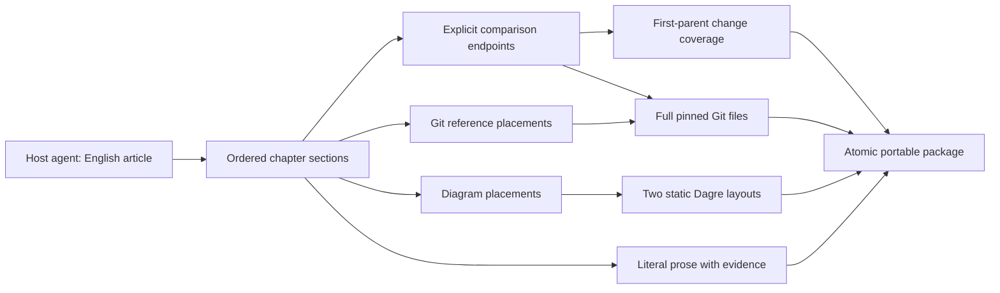

# Architecture

`src/contract.ts` owns artifact version 2. It has no Node dependencies and can be
vendored, with provenance, into the reader. Schema changes require an explicit
version decision; readers reject unsupported versions rather than guessing.
There is no legacy adapter. The [comparison extension](/adr/0003-comparison-blocks.md)
adds explicit diff endpoints without changing existing version-2 data.

This component view is inspection-maintained. Contract and package tests verify
the data relationships, Git bytes and complete dual-layout assets.

An agent submits narrative blocks, references, change assignments and graph data.
The builder will validate those relationships, resolve full files through Git,
render graphs without executing agent-provided markup, and produce the portable
artifact. Stored file checksums let the reader detect incomplete or modified imports.

The catalog identifies the source repository and lists PR manifests. A manifest
owns one generation, its frozen source, timeline, source-file index and diagrams.
Identical file bytes are stored once within a generation.

Diagram nodes cite code references. A source change belongs to one primary chapter;
other chapters may cite it as context. Each functional thread becomes one chapter.

The packaged `changes` inventory is deterministic: one changed source path per PR
commit. Every entry has one primary chapter, which must explain the
commit in a section. Other chapters may cite the same path. The builder, not the
agent, supplies the inventory. Contract validation checks coverage against it;
the builder additionally checks it against Git. Commit arrays are ancestor-first.
Chapters begin at the head, followed by ancestor-first historical sections.
References may also name the pinned base, merge base or head.
Generated-only and empty PR commits are listed explicitly in `excludedCommits`
with a reason, not silently dropped or turned into invented source changes.
The Git builder verifies inclusion, exclusion and ancestry against the real graph.
Git paths are metadata and may contain backslashes; only canonical, lowercase
asset paths are written to disk. Empty Git commit subjects are preserved.

Narrative is plain text, not Markdown or HTML. Only Git asset references are
authoritative code. The skill forbids copied source in prose; a schema cannot
prove that arbitrary prose is not invented code, so it does not claim to do so.
All exported schemas enforce relationship checks, including direct `safeParse`.

`src/git.ts` owns non-executing Git access, regular blob reads and paged history.
`src/snapshot.ts` owns changed-path inventory and included/excluded PR commit
classification. Neither reads working-tree source as evidence or invokes a model.

`src/package.ts` resolves the entire draft against a fresh frozen inventory and
returns a complete in-memory package. It owns historical ancestry checks, canonical
file assets, source metadata and profile hashing. `src/diagram.ts` turns the bounded
graph contract into compact, escaped portrait and landscape SVG using Dagre.
Viewport dimensions accompany checksums for automatic fitting. Neither writes
into the analyzed repository.
`src/comparison.ts` validates ancestor and file-presence relationships for diffs.
`src/authoring.ts` also matches every owned change to an exact first-parent diff
in its primary chapter. This publication policy does not tighten reader imports.
The reader compares complete source assets using a library; the builder never
accepts agent-supplied patches or rendered HTML.
`src/authoring.ts` applies the [visual-first publication policy](/bdr/0009-visual-first-authoring.md)
before packaging and at the MCP input boundary. This policy is separate from the
portable format so existing reader imports keep their version-2 meaning.
Contract node IDs map to opaque layout IDs, keeping graphlib object keys outside
the input boundary. Dagre owns self-loop, disconnected-component and parallel-edge
routing. Version 2.0.4 is pinned because 3.1.1 failed accepted geometry regressions.
The final viewport comes from all node, label and route bounds, not the engine's
incomplete self-loop viewport. No fallback renderer or custom self-loop/component
routing remains.

PR visual explanations are no longer generated by default. Permanent docs retain
the textual contract; explicitly requested product diagrams remain artifact data.

`src/github.ts` owns GitHub PR discovery and the native expected-head commit
operation through `gh`. `src/publication.ts` owns complete-asset checks, prior
generation identity, catalog updates and scoped deletion. It reads the pinned Git
tree and never changes the working tree, index or local branch. Its interaction
sequence and failure semantics live in [publication behavior](/bdr/0004-publication.md).

`src/lock.ts` owns exclusive local generation locks. `src/runtime.ts` binds an
operator-configured source root, frozen inventory, private profile and lock to one
session. `src/server.ts` registers validated MCP tools; `src/main.ts` starts the
official SDK's stdio serving entry for both protocol eras. The lifecycle and
shutdown sequence live in [generation sessions](/bdr/0005-generation-session.md).
Source reads expose a focus and a bounded, numbered context range for reuse as
an inline reference; see [code context](/bdr/0008-code-context.md).
The maintained Apache-2.0/MIT SDK packages own framing and negotiation rather than
a handwritten protocol. The server package depends only on core and existing Zod;
the official client is a development-only wire-test dependency.

`skills/raccoon/SKILL.md` is the portable host-agent explanation workflow. It
consumes the private preferences returned by begin, writes narrative and Git
references, and calls the deterministic MCP tools. Its generation flow lives in
[article behavior](/bdr/0007-article.md); operator setup lives in
[installation](/context/setup.md). Neither the skill nor server calls another model.
