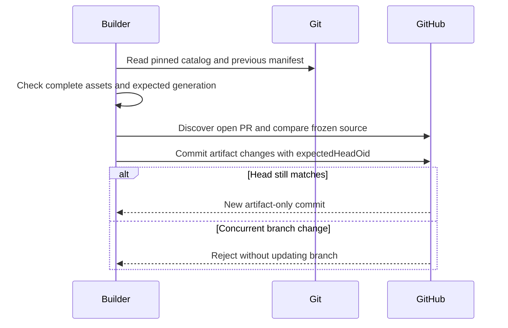

# Publish a complete generation

The [requirements](/prd/0001-understanding.md) and approved
[PR-branch destination](/adr/0001-offline-boundary.md) require publication without
changing source or replacing a generation accidentally. Input is a complete built
package and the previous generation UUID, or `null` for the first generation.
The server discovers the open GitHub PR and checks its repository, branch, base
and head against the frozen source. Fork PRs are rejected rather than publishing
private artifacts into a different repository implicitly.

Publication uses GitHub's `createCommitOnBranch` operation with `expectedHeadOid`.
One atomic artifact-only commit updates the catalog and the target PR's assets.
Only obsolete files named by the previous manifest are deleted. Other PRs and
unlisted notes are preserved. Unowned filename or directory collisions fail.
Git objects supply the existing catalog; local working files and the index are
never modified. Authentication uses the existing `gh` login, not source-repository
Git configuration, hooks, filters or credential helpers.

A service rejection leaves the prior branch unchanged. A lost response may follow
a successful remote commit: report an uncertain outcome and require inspection
before retrying. Never automatically retry publication or claim rollback.

<!-- mermaid-diagram: atomic-publication -->

<!-- /mermaid-diagram: atomic-publication -->

## Scenarios

1. Given a first generation, when published, create one commit containing only its
   complete assets and the repository catalog, with the frozen head as its parent.
2. Given dirty or staged local source, when published, preserve the working tree,
   index and local branch exactly.
3. Given a prior generation, when its expected UUID matches, replace only that PR's
   listed assets and catalog entry. Preserve unlisted notes and other PRs.
4. Given a missing or different expected UUID, when replacing, reject before mutation.
5. Given a changed PR base, head or branch, or a closed or fork PR, when publishing,
   reject. The final commit operation also checks the head atomically.
6. Given incomplete assets or an unowned path collision, when publishing, reject
   before any remote mutation.

## Test design

| Case | Level | Observable assertion and purpose |
|---|---|---|
| First publication | Git integration with GitHub boundary double | Exact complete artifact-only mutation includes expected head |
| Local source state | Git integration | Working bytes, staged tree and branch are unchanged |
| Expected regeneration | Git integration | Only prior managed assets are removed; other catalog entries and notes survive |
| Stale generation or source | Git integration | No mutation is submitted for an obsolete identity |
| Incomplete assets or collision | Git integration | Unsafe or partial changes never reach GitHub |
| Closed or fork discovery | Unit | A different publication destination is never inferred |

The sequence view is checked by inspection against the native GitHub mutation;
the boundary double verifies its exact atomic precondition, not GitHub internals.

# References

1. GITHUB. *CreateCommitOnBranchInput and FileChanges GraphQL schema*. Available at:
   <https://docs.github.com/en/graphql/reference/input-objects#createcommitonbranchinput>.
   Accessed on: 2026-10-18. Fields verified through authenticated schema introspection.
