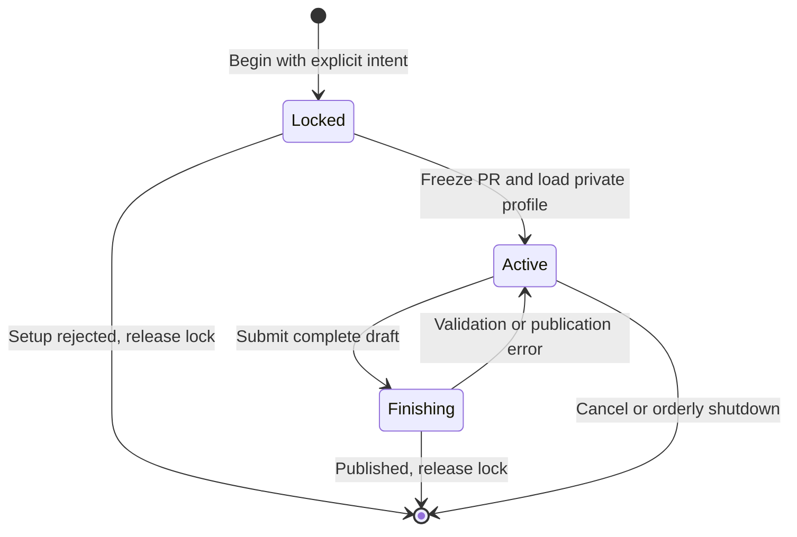

# Generation sessions and MCP tools

The [constitution](/constitution.md) requires one active generation per PR and
explicit complete regeneration. A local stdio MCP process serves the host agent
on the VPS. There is no public HTTP listener, model subprocess or AI credential.
Only repositories explicitly mapped by the operator can be inspected or published.
Existing Raccoon configuration files are not read or rewritten.

An inspection returns the frozen PR inventory and current generation UUID. Beginning
a generation acquires an exclusive cross-process lock, repeats inspection, checks
create versus expected-UUID regeneration intent, and privately loads the reader
profile. The profile and lock directory must be outside configured source roots;
profile files and lock state cannot be group- or world-accessible.

The host reads paged Git paths, files, diffs and history using the returned session
UUID. It submits one complete draft. Finish builds the package and invokes
[atomic publication](/bdr/0004-publication.md). Concurrent finishes or cancellation
during finish are rejected. Validation errors leave the session available to fix
the complete draft; no partial generation is stored or published.

Successful publication ends the session. A subsequent lock-cleanup failure is a
warning on success, not a false rollback. Explicit cancellation and orderly shutdown
release locks; shutdown waits for in-flight setup and publication. Crashes leave a fail-closed lock:
the operator must stop its owning process before removing that exact lock file.
There is no time-based lock stealing or automatic publication retry.

<!-- mermaid-diagram: generation-lifecycle -->

<!-- /mermaid-diagram: generation-lifecycle -->

## Scenarios

1. Given two processes requesting the same PR, when one holds its lock, reject the
   second. Repository-name case variations identify the same PR.
2. Given an interrupted process, when another begins, preserve the stale lock and
   require deliberate operator recovery rather than assuming it expired.
3. Given an unmapped repository, when inspected or begun, reject before GitHub access.
4. Given an existing artifact, when beginning, require explicit regeneration intent
   with its matching UUID before returning a usable session.
5. Given an active session, when finishing with a complete draft, publish once and
   return the generation and commit IDs. Reject overlapping finish/cancel requests.
6. Given invalid evidence, when finishing, keep the previous generation untouched
   and permit a corrected complete draft in the same session.
7. Given an orderly close, when setup or publication is still running, wait before lock
   cleanup. Reject new work after shutdown starts.
8. Given an MCP client using either the classic or 2026-07-28 handshake, when
   connected, expose the same validated tools. Source content remains untrusted data.

## Test design

| Case | Level | Observable assertion and purpose |
|---|---|---|
| Process contention and crash | Filesystem/process integration | Exclusive locks work across processes and are never stolen |
| Session authorization and regeneration | Git integration | Only mapped PRs with explicit matching intent can become active |
| Finish lifecycle | Git integration with GitHub boundary double | One publication, recoverable validation failure and safe shutdown |
| Wire compatibility | Stdio integration with official client | Both protocol eras list and call the real tools |

The lifecycle diagram is inspection-checked against runtime transitions. The
official SDK owns protocol framing and handshake negotiation. Its 10 MiB stdio
message limit bounds a draft, not full packaged Git source or total history depth.
Evidence responses over 4 MiB fail with a request for a smaller page rather than
silently truncating source. Individual Git command bounds still apply.

## Review amendment

Beginning a generation propagates MCP cancellation through setup. Cancellation
before delivery and response-size rejection both release the new session instead
of retaining a lock whose UUID never reached the client. Real MCP regressions
cover a 12,000-file inventory and cancellation during blocked discovery.

Cancellation cleanup remains armed while the SDK delivers a begin response, not
only while constructing it. A transport-backpressure regression cancels after
the handler returns but before delivery completes, then reacquires the PR lock.
