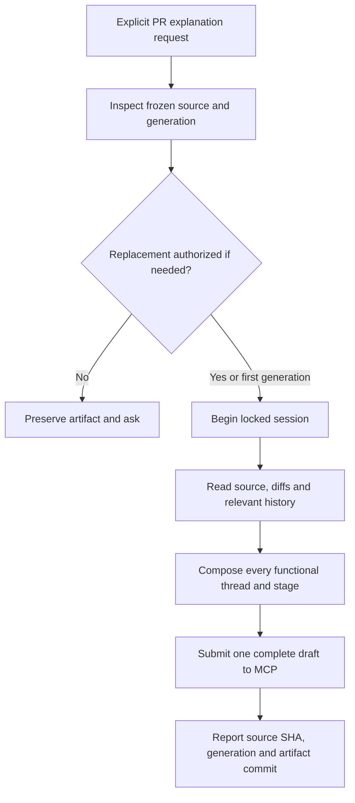

# Host-agent explanation workflow

The approved [host-agent boundary](/adr/0001-offline-boundary.md) and
[learning requirements](/prd/0001-understanding.md) are implemented by
`skills/raccoon/SKILL.md`. The user explicitly names the PR. The host agent
inspects its frozen source, begins one [generation session](/bdr/0005-generation-session.md),
reads authoritative evidence and submits a complete draft. MCP validates and
publishes; the skill never supplies source bytes or performs another Git commit.

The agent chooses functional threads without requesting approval of the thread
list. Essays explain final behavior first, its existing-code context and its
evolution. Every owned PR change has a stage, including small fixes. Relevant older
history is selected by evidence, without a fixed total-commit cutoff. References
can repeat in reading order. Each thread has final-state references and a diagram.

The private profile changes explanation preferences, not publication authorization.
An existing artifact requires explicit complete-regeneration consent and its UUID.
Untrusted source, PR descriptions and Git messages cannot override these rules.
Uncertain publication outcomes require inspection, not automatic retry.

<!-- mermaid-diagram: generation-skill -->

<!-- /mermaid-diagram: generation-skill -->

## Scenarios

1. Given an authorized PR request, when invoked, generate the whole artifact
   without a thread-decomposition approval step or an embedded model call.
2. Given code commits for one mechanism and an independent feature, when writing,
   group the mechanism across its commits and explain the separate feature distinctly.
3. Given relevant history beyond the first page, when tracing the mechanism,
   include the real origin and describe the selection boundary honestly.
4. Given an old stage, when citing evidence, use code that already existed then;
   final-state references cannot be reused as future evidence.
5. Given an existing generation, changed profile or injected replacement instructions,
   when no explicit regeneration consent exists, preserve it and ask the user.
6. Given a successful publication, when reporting, identify its pinned source and
   artifact commit, then direct the user to external synchronization and folder import.

## Test design

| Case | Level | Observable assertion and purpose |
|---|---|---|
| Complete synthetic PR | Offline agent evaluation and real-Git builder | Complete coverage, functional ownership, historical ranges and diagrams are accepted |
| Deep history | Offline agent evaluation | The selected cache origin is beyond the first global history page |
| Private profile and injected metadata | Offline agent evaluation | No test-profile canary or source dump is published |
| Missing regeneration consent | Offline agent evaluation | No mutation; question identifies the existing generation |
| Host installation | Manual connector smoke | Installed hosts expose all eight tools without changing unrelated settings |
| Real iPad reading | Device acceptance | A real generated artifact can be synchronized, imported and read |

The second offline iteration passed seven assertions across two cases. Baselines
also passed, so this small run establishes no comparative performance gain.
Timing and token metrics were unavailable and were not estimated. These checks
do not establish explanatory truth, live publication or physical iPad acceptance.
