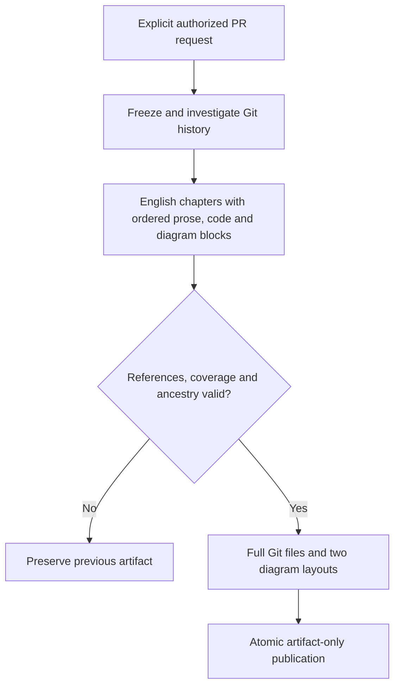

# Complete article generation

This implements [article requirements](/prd/0002-continuous-article.md) and the
[ordered contract](/adr/0002-article-contract.md), replacing the
[old contract](/bdr/0001-contract.md), [packaging](/bdr/0003-packaging.md) and
[authoring model](/bdr/0006-generation-skill.md).

The host agent follows the installed skill, investigates every owned change and
relevant pre-PR history, then submits one complete draft. Only the server resolves
source and renders diagrams. Private profile text is never published. Existing
authorization, locking, expected-generation and uncertain-outcome rules still apply.

## Scenarios

1. Given a complete English draft, when packaged, preserve block order and include
   exact Git files plus portrait and landscape assets for every placed diagram.
2. Given unknown, unused or duplicate IDs, missing prose/code/diagram placement or
   incomplete ownership, when validated, reject rather than silently repair.
3. Given a historical section citing future code or a future diagram, when built,
   reject the package. A chapter's first section cites and illustrates the head.
4. Given an old format, when parsed, reject it without migrating or deleting data.
5. Given long labels, cycles or branching, when rendered, escape text and retain
   the complete graph geometry inside both viewports.

## Test design

| Case | Level | Observable assertion and purpose |
|---|---|---|
| Ordered block graph | Unit | Accept intact content; reject dangling placement, old shapes and bad coverage |
| Exact historical evidence | Git integration | Dirty files cannot enter; future references and diagrams fail |
| Dual diagram geometry | Unit | Nodes, labels and routed paths remain in bounds in either layout |
| Complete publication | Integration | Both layouts are owned, checksummed and atomically replaced |
| Authoring guidance | Manual offline evaluation | English continuous prose, inline evidence and honest history; no claim of automated prose-quality validation |

Acceptance: relevant checks pass and no legacy generation or reader path remains.
