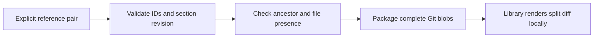

# Git comparisons

Implements the [comparison decision](/adr/0003-comparison-blocks.md).

1. Given a pair of existing references, packaging keeps both complete Git files.
2. Given missing, identical or dangling endpoints, reject the complete draft.
3. Given an alleged addition/deletion, reject unless Git proves the missing side.
4. Given an existing empty file, preserve its blob, not an absent-file sentinel.

| Scenario | Level | Purpose |
|---|---|---|
| 1, 3, 4 | Git integration | Authoritative comparison assets and presence |
| 2 | Contract unit | Invalid endpoint relationships cannot enter an artifact |

Acceptance: `make test`; failures preserve the existing generation. Rendering
remains a reader responsibility, not server-generated executable markup.
