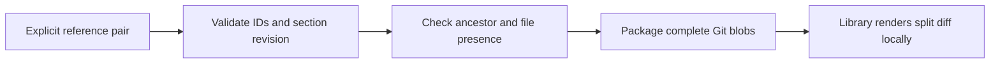
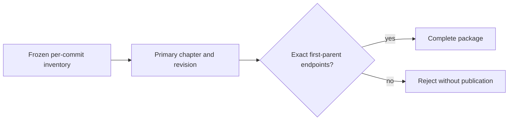

# Git comparisons

Implements the [comparison decision](/adr/0003-comparison-blocks.md).

1. Given a pair of existing references, packaging keeps both complete Git files.
2. Given missing, identical or dangling endpoints, reject the complete draft.
3. Given an alleged addition/deletion, reject unless Git proves the missing side.
4. Given an existing empty file, preserve its blob, not an absent-file sentinel.

| Scenario | Level | Purpose |
|---|---|---|
| 1, 3, 4 | Git integration | Authoritative comparison assets and presence |
| 2 | Contract unit | Invalid endpoint relationships cannot enter an artifact |

Acceptance: `make test`; failures preserve the existing generation. Rendering
remains a reader responsibility, not server-generated executable markup.

## Amendment, 2026-10-22: complete change coverage

Given an owned inventory change, when generating an article, require a diff in
its primary chapter at that change's commit. Its existing endpoints use that
path at the commit and its exact first parent, including generated-only parents.
Additions use `before: null`; deletions use `after: null`. A comparison against
an older ancestor may provide extra context, but cannot cover an individual
inventory change. Renames remain explicit deletion/addition pairs.

| Case | Level | Proves |
|---|---|---|
| Added, deleted, modified | Authoring unit | Missing-side and first-parent matching |
| Wrong path, baseline or owner | Authoring unit | Unrelated comparisons cannot cover a change |
| Sequential code without diff | Package integration | New publication cannot bypass the policy |

Existing portable v2 imports are unaffected. Current mechanism and surrounding
code remain separate highlighted context, not substitutes for change comparisons.
